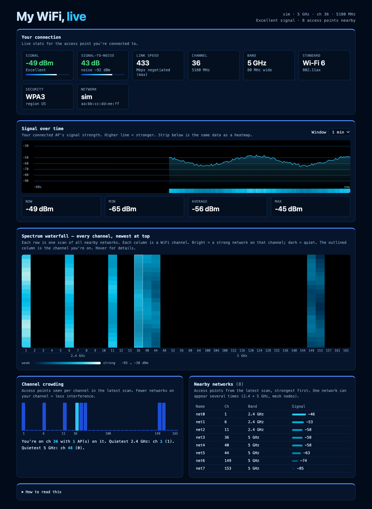

# wifiview

Live WiFi dashboard for macOS. A small Swift helper reads your Mac's WiFi radio, a zero-dependency Node server streams it, and a web page draws it.



*Screenshot uses simulated data (`./run.sh --sim`) so no real network names are shown.*

- **Your connection:** signal (dBm), SNR, link speed, channel and frequency, band, width, Wi-Fi generation, security, network name.
- **Signal over time:** line chart plus heat strip, with a 30 s / 1 min / 5 min window.
- **Spectrum waterfall:** every channel over time. Brighter means a stronger network. Hover for details.
- **Channel crowding:** access points per channel, with a quietest-channel suggestion.
- **Nearby networks:** names, channel, band and signal, strongest first.

## Quick start

```sh
./run.sh
```

That builds the scanner on first run, starts the server and opens <http://127.0.0.1:3000>.
`npm start` does the same.

Try it without WiFi access using fake data:

```sh
./run.sh --sim      # or: npm run sim
```

### Requirements

- macOS 11 or later
- Node 18 or later
- Xcode Command Line Tools for `swiftc` (`xcode-select --install`)

## Showing network names (Location permission)

macOS only reveals the names (SSIDs) of WiFi networks to apps that have Location access. Without it the page still works, but networks appear as "Unnamed AP".

`run.sh` builds the scanner as a small background app, `WifiviewScan.app`, so macOS can ask for permission for it directly:

1. Run `./run.sh`. A macOS prompt asks to allow **WifiviewScan** to use your location. Click **Allow**.
2. If you missed it, open **System Settings → Privacy & Security → Location Services**, turn on **WifiviewScan**, then restart `./run.sh`.

The page shows a banner whenever permission is missing. Location data is not read or stored. The permission is only what macOS requires to unlock network names.

## Options

Set these as environment variables:

| Variable | Default | Meaning |
|---|---|---|
| `PORT` | `3000` | Server port. The server only listens on `127.0.0.1`. |
| `RSSI_MS` | `250` | Poll interval for your connected AP. Can go down to 10 ms. |
| `SCAN_GAP_MS` | `1000` | Pause between full channel scans. A scan itself takes about 2–4 s. |
| `NO_OPEN` | unset | Set to `1` to skip opening the browser. |

Example: `RSSI_MS=50 SCAN_GAP_MS=0 PORT=3001 ./run.sh`

Page options: `http://127.0.0.1:3000/?row=2` makes waterfall rows 2 px tall (default 6), which shows more history.

## How it works

```
WifiviewScan.app (Swift, CoreWLAN)  --JSON lines via FIFO-->  server.js (Node)  --SSE /events-->  index.html (canvas)
```

- `scan.swift`: polls the connected AP's RSSI and noise, and runs full scans of nearby networks. Requests Location access so names are visible.
- `server.js`: launches the scanner app with `open` (it writes JSON lines to a named pipe in your temp folder) and forwards each line to browsers over Server-Sent Events. `--sim` generates fake data instead.
- `index.html`: the whole UI, no build step.
- `Info.plist`: becomes the app bundle's plist (`WifiviewScan.app`) so macOS can show a Location prompt.
- `run.sh`: builds, starts and opens everything.

## Limits

- Resolution is per channel. Per-subcarrier CSI heatmaps (like ESP32 CSI demos) need extra hardware, because macOS does not expose CSI.
- Link speed is what your Mac and router negotiated, not measured throughput.
- 6 GHz networks are counted in the table but not drawn in the waterfall.
- Constant scanning (`SCAN_GAP_MS=0`) can briefly disturb your connection.

## Troubleshooting

- **`swiftc not found`:** run `xcode-select --install`.
- **Port busy:** `PORT=3001 ./run.sh`, or stop the old server with `pkill -f "node server.js"`.
- **Page says offline:** the server stopped. Check the terminal output.
- **`no wifi interface`:** your Mac has WiFi turned off or no WiFi hardware.
- **Names still missing after allowing:** restart `./run.sh` and make sure **WifiviewScan** is enabled under Location Services.
- **Scanner app exits right away:** check `$TMPDIR/wifiview-scan.err` for its error output.
